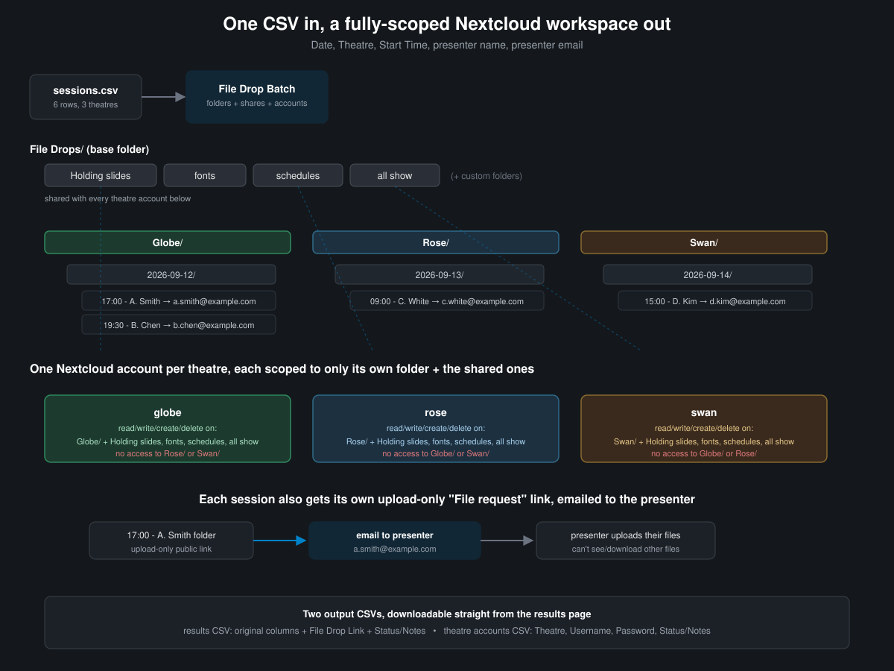
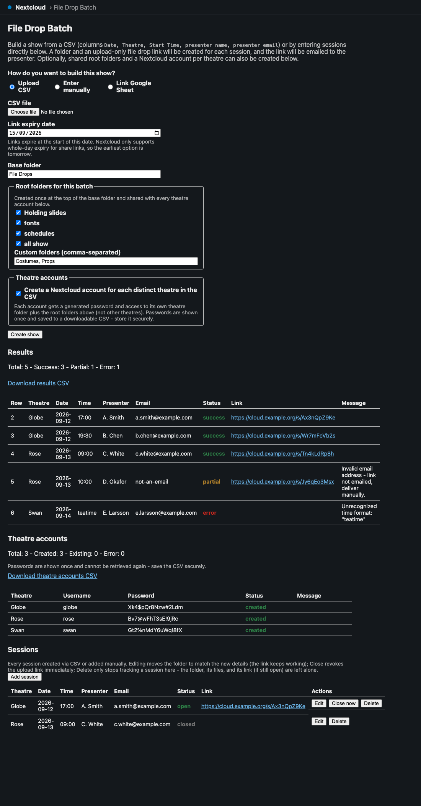
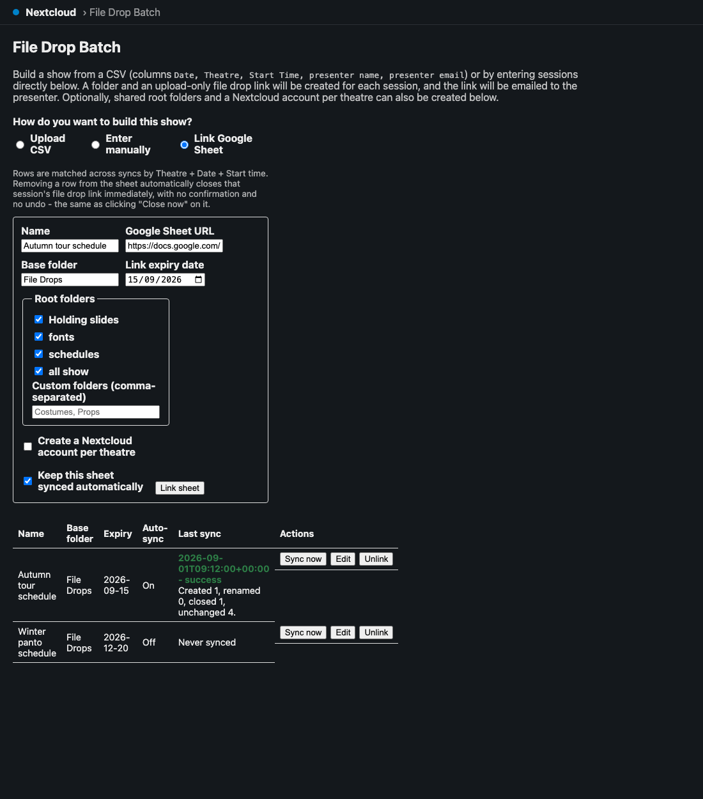
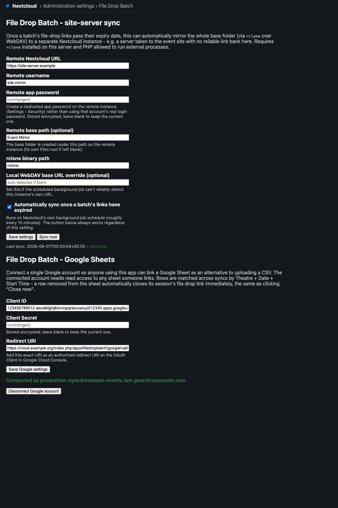

# File Drop Batch

[](https://github.com/stoatworks-labs/nc-filedropbatch/actions/workflows/lint.yml)
[](https://github.com/stoatworks-labs/nc-filedropbatch/actions/workflows/test.yml)
[](https://github.com/stoatworks-labs/nc-filedropbatch/actions/workflows/release.yml)

> **AI-assisted project.** This codebase was created with [Claude Code](https://claude.com/claude-code)
> (Anthropic), directed and reviewed by a human author. That covers the code, the docs and
> the visuals in this README. Check it over yourself before you rely on it for a show, as you
> would with any code.

A Nextcloud app for theatre and event production teams. You build a show (from a CSV, typed in
by hand in the browser, or synced live from a Google Sheet) and it will:



- create a nested folder per session (`Theatre / Date / "Start Time - Presenter"`),
- create an upload-only "file drop" public link for each folder, with one expiry date for the whole batch,
- email each presenter their link,
- hand back a CSV with a `File Drop Link` column added, when you've built from a CSV.

If you want, it can also:

- create a set of shared root folders (`Holding slides`, `fonts`, `schedules`, `all show`, plus custom names) once at the top of the batch, and
- create a Nextcloud account per distinct theatre, scoped to its own theatre folder plus the shared root folders (not other theatres), with a generated password saved to a downloadable CSV. Only admins and subadmins can create accounts.
- once a batch's file-drop links pass their expiry, automatically mirror the whole base folder to a separate Nextcloud instance (a server you take to the event site, say) via `rclone` over WebDAV. See [Site-server sync](#site-server-sync) below.
- keep track of every session in a persistent Sessions list, where you can edit its details, close its link early, or remove it. See [Managing sessions](#managing-sessions) below.
- build a show straight in the browser instead of preparing a CSV, or link a Google Sheet and keep it live-synced, where removing a row from the sheet automatically closes its session. See [Building a show without a CSV](#building-a-show-without-a-csv) below.

<!-- downloads:start -->

## Download

**[v1.5.1](https://github.com/stoatworks-labs/nc-filedropbatch/releases/tag/v1.5.1)**

This release contains:

- [`filedropbatch-1.5.1.tar.gz`](https://github.com/stoatworks-labs/nc-filedropbatch/releases/download/v1.5.1/filedropbatch-1.5.1.tar.gz) — Nextcloud app package, 58 KB

All builds, checksums and release notes: [github.com/stoatworks-labs/nc-filedropbatch/releases](https://github.com/stoatworks-labs/nc-filedropbatch/releases).

<!-- downloads:end -->

## The upload page



*A static mockup built from the app's own CSS/markup with made-up sample data, not a live capture. See [`docs/mockups/app-preview.html`](docs/mockups/app-preview.html).*



*The same kind of mockup, showing the Google Sheets mode. See [`docs/mockups/sheets-preview.html`](docs/mockups/sheets-preview.html).*



*The one-time admin setup screen for both the rclone remote and the Google OAuth connection. See [`docs/mockups/admin-settings-preview.html`](docs/mockups/admin-settings-preview.html).*

## Input CSV format

```
Date, Theatre, Start Time, presenter name, presenter email
```

## Documentation

| Doc | Contents |
|---|---|
| [docs/USER-GUIDE.md](docs/USER-GUIDE.md) | Running a batch: the CSV, expiry, reading the results, theatre accounts, troubleshooting |
| [docs/API.md](docs/API.md) | HTTP routes, the session-CSV contract, admin config keys, tables, background jobs |
| [docs/DEVELOPING.md](docs/DEVELOPING.md) | The pipeline, migrations, tests, and the security rules |

Two things worth knowing before your first batch, both covered in the user guide:
**ambiguous dates are read day-first** (`03/04/2026` is 3 April), and **a link set to expire on
a date stops working at 00:00 that day**, so set the expiry to the day *after* uploads should
stop.

## Installing

**Requirements:** PHP 8.1+ and Nextcloud 27-31 (see `<dependencies>` in `appinfo/info.xml`). There
are no Composer dependencies at all: the app only uses Nextcloud's built-in OCP APIs (`IRootFolder`,
`Share\IManager`, `IUserManager`, `IMailer`, `IClientService`). Two features are entirely optional
and need nothing extra if you don't use them:

- **Site-server sync** needs `rclone` installed on the server and PHP allowed to spawn external processes (`proc_open`). See [Site-server sync](#site-server-sync).
- **Google Sheets sync** needs a Google Cloud project with the Sheets API enabled and an OAuth 2.0 Client ID/Secret. See [Building a show without a CSV](#building-a-show-without-a-csv).

You don't need either of them for the core CSV, manual entry, file drop and session management side of things.

### Option A - install a release (recommended)

1. Download `filedropbatch-<version>.tar.gz` from the [Releases page](https://github.com/stoatworks-labs/nc-filedropbatch/releases).
2. Extract it into your Nextcloud instance's app directory. It already has the right `filedropbatch/` top-level folder in it:
   ```
   tar -xzf filedropbatch-<version>.tar.gz -C /path/to/nextcloud/custom_apps/
   ```
3. Make sure the web server owns the extracted files, e.g. `chown -R www-data:www-data /path/to/nextcloud/custom_apps/filedropbatch`.
4. Enable it, either from **Settings → Apps** in the Nextcloud web UI, or via `occ`:
   ```
   occ app:enable filedropbatch
   ```

### Option B - install from source

Clone this repository and copy (or symlink) `custom_apps/filedropbatch` into your Nextcloud instance's
`custom_apps` (or `apps`) directory, then run the same `occ app:enable filedropbatch` as above. That's
how this repo's own [local dev environment](#local-dev-environment) below does it.

### After enabling

The app adds a "File Drop Batch" entry to the Nextcloud navigation bar, and any logged-in user can open
it and build a show straight away. You don't need to do anything else unless you want site-server sync
or Google Sheets sync, which an admin sets up once under **Settings → Administration → File Drop
Batch** (see the two linked sections above).

### Note on link expiry

Nextcloud's public link share expiration only goes by date: the server truncates both the expiration date and "now" to midnight before comparing them, so the earliest valid expiry is always tomorrow, and the share effectively expires at 00:00 on the chosen date, whatever time you might otherwise expect. That's how Nextcloud behaves, and this app can't override it.

## Managing sessions

Every session, whether it came from a CSV row or was added on its own, is tracked in a Sessions list on the main page, with three actions:

- **Edit** changes the theatre, date, start time or presenter name, and **moves the folder itself** to match (renaming the time updates the `"17:00 - A. Smith"` folder, for example). This works because Nextcloud shares point at a folder by its internal file id, not its path, so the existing file-drop link still leads to the same folder after the move. The presenter isn't emailed again, since only the folder location and the displayed details changed, not the link.
- **Close now** revokes that session's file-drop share outright, straight away, and it can't be undone. There's no grace period and no reopening it (you'd have to create a fresh session instead). It only affects that one session. Other sessions in the same batch, and the batch's own site-server sync schedule, are left alone, and closing does **not** trigger an early sync.
- **Delete** only removes the session from this list. The folder, anything uploaded into it, and its share (if you haven't closed it separately) are left just as they are. If you actually want the folder gone, do that separately in Files.

"Add session" on the same page creates a single session without a CSV, through the same folder/share/email logic as a CSV row (including its own expiry date, since Nextcloud's link expiry is set per share and this app can't edit it afterwards).

A session created or last touched by a linked Google Sheet can also be closed *for you*, automatically, the moment its row disappears from that sheet. See [Building a show without a CSV](#building-a-show-without-a-csv) above.

## Building a show without a CSV

The main page's "How do you want to build this show?" switcher gives you two alternatives to uploading a CSV file:

- **Enter manually:** the same fields a CSV row would have (Theatre, Date, Start time, Presenter name, Presenter email), added a row at a time in the browser and submitted together as one show. It goes through the same folder/share/email pipeline as a CSV upload, so it behaves no differently. It's just another way to get the rows in.
- **Link Google Sheet:** point the app at a Google Sheet with the same five columns, and it stays synced. A background job re-checks it roughly every 20 minutes (and there's a "Sync now" button for when you can't wait), and rows are matched across syncs by **Theatre + Date + Start Time** rather than any hidden ID column, so:
  - a presenter name or email changed on an existing row updates that session (moving its folder if the name or slot changed, and the file-drop link keeps working, same as a manual edit);
  - a brand new Theatre+Date+Start Time combination creates a new session, just like a new CSV row;
  - **a row removed from the sheet closes that session's file-drop link straight away, with no confirmation and no undo.** I made this more aggressive than anything else in the app on purpose (deleting a session anywhere else never touches the folder or share), and it means an accidental row deletion in the spreadsheet kills a live upload link the moment the next sync runs. Turn off "Keep this sheet synced automatically" on a linked sheet if that isn't what you want for it.

**Setup (once, by an admin):** in Nextcloud admin Settings → File Drop Batch, under "Google Sheets", create an OAuth 2.0 Client ID in [Google Cloud Console](https://console.cloud.google.com/) (any project with the Google Sheets API enabled), add the "Redirect URI" shown on that settings page as an authorized redirect URI on the client, paste the Client ID/Secret in, save, then click "Connect Google account" and get through Google's consent screen. It's a single, **instance-wide** connection (like the rclone remote credential), not a per-user one, so the connected account needs read access to every sheet anyone links. After that, any signed-in user can link a sheet from the main page without needing their own Google OAuth setup.

## Site-server sync

Once a batch's file-drop links pass their expiry date (so no more uploads are expected), a background job can mirror the whole base folder (root folders, theatre folders, everything collected) to a second, separate Nextcloud instance over WebDAV, using [`rclone`](https://rclone.org/). It's for when the venue itself has no reliable link back to this server: you take a "site server" with you, loaded with everything up to the last sync.

**Requirements:** `rclone` installed on this server and reachable on `$PATH` (or point at it explicitly in settings), and PHP allowed to spawn external processes (`proc_open`). That's normal on a self-hosted box you control, and often disabled on shared hosting. It's the one place I've let this app depend on something external, and only for this optional feature.

**Configure it** under Nextcloud's admin Settings → File Drop Batch: the remote instance's URL, a username, and an **app password** you create on that remote instance (Settings → Security → "Create new app password"; never use a real account password here), plus an optional remote base path and an "automatically sync on expiry" toggle. A "Sync now" button runs it on demand whatever the toggle says, which is useful for testing the connection.

**How it authenticates:** the destination (remote) leg uses the app password you configure, encrypted at rest. The source (this server) leg never stores a password at all. Each sync mints a fresh, short-lived Nextcloud app token for the batch's owner, uses it for the local WebDAV connection, and revokes it straight afterwards, whether the sync worked or not.

**Scheduling:** a small database table (`fdb_batches`) records each batch's owner, base folder and expiry date when it's created. A background job (riding on Nextcloud's own cron, so you don't need an extra system cron entry) checks roughly every 15 minutes for batches whose expiry has passed and that haven't been synced yet, and triggers one whole-folder sync per distinct (user, base folder) pair. It isn't a sync per batch, since `rclone sync` only transfers the differences anyway. A failed sync is logged and left to retry on the next run rather than marked done.

**Set the "local WebDAV base URL" explicitly** if this instance runs behind Docker, a reverse proxy, or anything else where the request that reaches PHP doesn't carry the same hostname the outside world uses. Auto-detection (via Nextcloud's own URL generator) reflects whatever `overwrite.cli.url`/trusted-domain resolution produces for a CLI/cron context, which in a typical `docker-compose` setup gives you the *host-mapped* address (e.g. `localhost:8080`) rather than the address reachable from *inside* the container where `rclone` runs (e.g. plain `http://localhost`, since Apache listens on port 80 internally). I confirmed that while testing this feature against the bundled dev stack. If the source leg of a sync fails with a connection error even though the destination is reachable, this is almost always why.

## Local dev environment

`docker-compose.yml` brings up a throwaway Nextcloud + MariaDB + MailHog stack for development. Credentials are read from a `.env` file (gitignored) rather than committed:

```
cp .env.example .env
# edit .env and set real passwords

docker compose up -d
docker compose exec -u root app chown www-data:www-data /var/www/html/custom_apps
docker compose exec -u www-data app php occ maintenance:install \
  --database mysql --database-host db --database-name nextcloud \
  --database-user nextcloud --database-pass "$(grep DB_PASSWORD .env | cut -d= -f2)" \
  --admin-user admin --admin-pass "$(grep NEXTCLOUD_ADMIN_PASSWORD .env | cut -d= -f2)"
docker compose exec -u www-data app php occ config:system:set mail_smtpmode --value=smtp
docker compose exec -u www-data app php occ config:system:set mail_smtphost --value=mailhog
docker compose exec -u www-data app php occ config:system:set mail_smtpport --value=1025
docker compose exec -u www-data app php occ config:system:set mail_smtpauth --value=0 --type=integer
docker compose exec -u www-data app php occ app:enable filedropbatch
```

Nextcloud is then at `http://localhost:8080` (log in with the admin user/password you set in `.env`) and MailHog at `http://localhost:8025`.

You need the manual `chown`/`maintenance:install` steps because the `custom_apps` directory ships owned by `root` in the official image, which makes the container's own automatic installer fail on a fresh volume.

There are two sample CSVs: `sample-sessions.csv` (a clean, everything-goes-right file) and `sample-sessions-edge-cases.csv` (duplicate rows, an invalid email, a bad date/time, missing fields, to exercise the success/partial/error paths).

### Testing the site-server sync locally

`docker-compose.site-server.yml` stands up a second, independent Nextcloud instance to act as the "site server", so you can exercise the rclone sync end to end without a second machine. It needs its own set of `.env` values (`SITE_DB_ROOT_PASSWORD`, `SITE_DB_PASSWORD`, `SITE_ADMIN_USER`, `SITE_ADMIN_PASSWORD`; see `.env.example`) and runs as a separate compose project so it doesn't collide with the primary stack:

```
docker compose --env-file .env -p fdb-site -f docker-compose.site-server.yml up -d
```

That puts the site instance at `http://localhost:8081`. From inside the primary `app` container, reach it via Docker Desktop's `http://host.docker.internal:8081` (its published port isn't reachable via `localhost` from another container). That's the URL to enter as the "Remote Nextcloud URL" in admin settings, with an app password created on the site instance (Settings → Security) as the remote password. `rclone` itself isn't in the official Nextcloud image, so install it into the primary container for testing: `docker compose exec -u root app bash -c "curl -s https://rclone.org/install.sh | bash"`.

To pretend a batch's expiry has passed (new batches always need an expiry of at least tomorrow, so none will be due on their own yet), backdate it directly: `docker compose exec db mysql -u nextcloud -p"$DB_PASSWORD" nextcloud -e "UPDATE oc_fdb_batches SET expiry_date = '2020-01-01' WHERE id = 1;"`. Then either wait for real cron activity, or trigger the job straight away with `occ background-job:list` (to find its id) followed by `occ background-job:execute <id>`. `cron.php` on its own only advances one due job per invocation (that's intended, and matches how a real system cron ticks over time), so running it by hand repeatedly isn't a reliable way to test a particular job on demand.

## Running tests

A small PHPUnit suite covers the pure logic that doesn't depend on the Nextcloud runtime
(`PathSanitizer`, `CsvReader`). It needs no Nextcloud instance, database or Composer install:

```
cd custom_apps/filedropbatch
phpunit
```

CI runs this on every push/PR (see the `test` badge above), alongside a `lint` job that
`php -l`s every file and checks `appinfo/info.xml` is well-formed. Everything else (controllers
and services that depend on Nextcloud's runtime, like `IRootFolder`, `Share\IManager` and so on)
is checked by hand against a real instance instead (see [Local dev
environment](#local-dev-environment) above).

## Roadmap / TODO

- [ ] Replace the static README mockup with a live screenshot captured from a running instance (the local `docker-compose` dev stack above stands one up).

## License

AGPL-3.0, matching Nextcloud's own app licensing convention.
